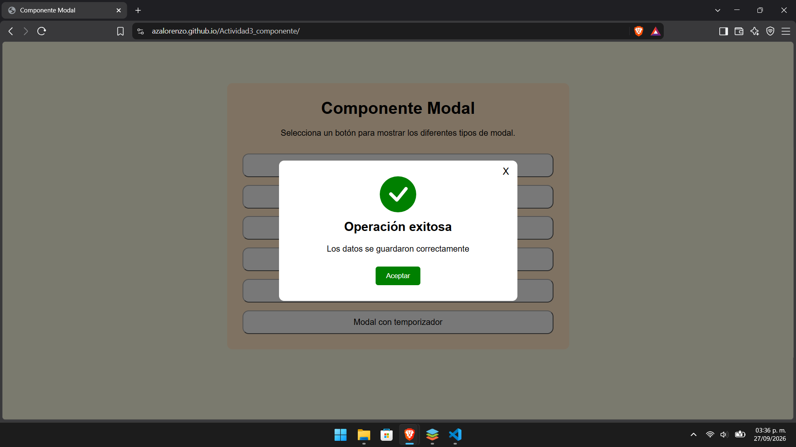
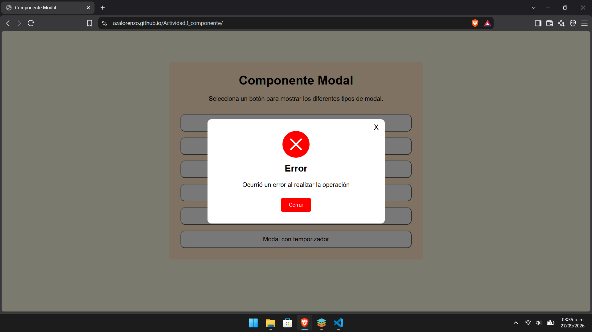
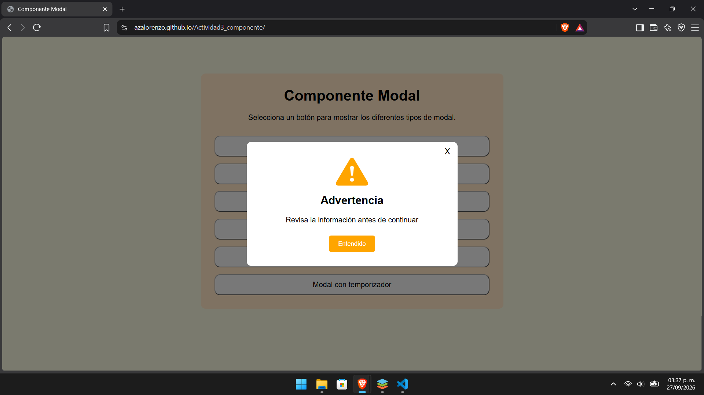
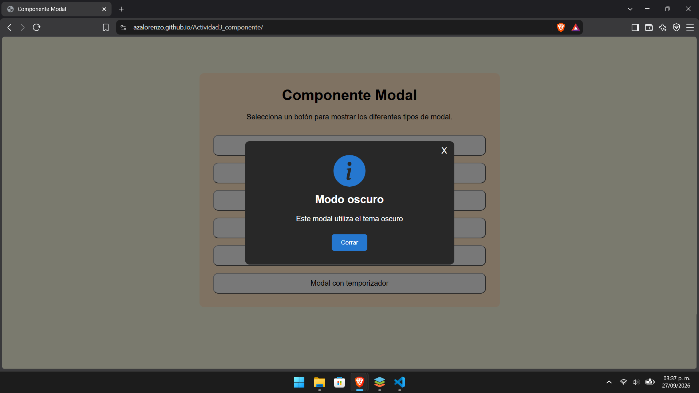
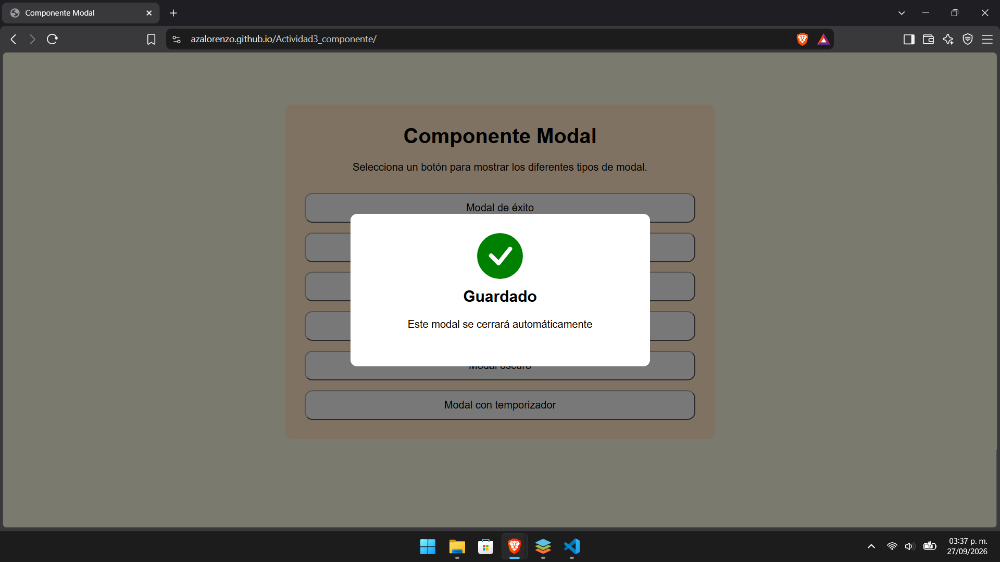

# Componente Modal en JavaScript

**Nombre:** Azael Chavez Lorenzo  
**Materia:** Programación Web

## Descripción

Este proyecto contiene un componente modal creado con HTML, CSS y JavaScript, este componente busca facilitar la creación de ventanas modales dentro de una página web, evitando tener que crear nuevamente su estructura cada vez que se necesite mostrar un mensaje.
El modal permite cambiar su título, mensaje, tipo, texto del botón y tema dependiendo de lo que se necesite mostrar.

Actualmente cuenta con cuatro tipos de mensajes:

- Éxito
- Error
- Advertencia
- Información

También cuenta con opciones como lo son tema claro y oscuro, cierre mediante el botón, o utilizando la X o haciendo clic fuera del modal, además de forma opcional se puede indicar un tiempo para que el modal se cierre automáticamente y también se puede decidir si se desea mostrar el botón de cerrar y la X.

## Instalación

Primero se debe clonar este repositorio para obtener los archivos del proyecto:

```bash
git clone https://github.com/azalorenzo/Actividad3_componente.git
```

Para utilizar el componente se deben incluir los archivos `componente.css`, `componente.js` y los archivos `.svg` dentro del proyecto.

La estructura de archivos debe organizarse de la siguiente manera:

```text
proyecto/
├── index.html
├── css/
│   └── componente.css
├── js/
│   └── componente.js
└── img/
    ├── exito.svg
    ├── error.svg
    ├── advertencia.svg
    └── informacion.svg
```

Dentro del `<head>` del archivo HTML se debe agregar el CSS:

```html
<link rel="stylesheet" href="css/componente.css" />
```

Y antes de cerrar el `<body>` se agrega el archivo JavaScript:

```html
<script src="js/componente.js"></script>
```

Un ejemplo básico quedaría de la siguiente forma:

```html
<!doctype html>
<html lang="es">
  <head>
    <meta charset="UTF-8" />
    <meta name="viewport" content="width=device-width, initial-scale=1.0" />
    <link rel="stylesheet" href="css/componente.css" />
    <title>Ejemplo Modal</title>
  </head>

  <body>
    <script src="js/componente.js"></script>
  </body>
</html>
```

## Uso

Para mostrar un modal se utiliza la función `mostrarModal()`.

```javascript
mostrarModal(titulo, mensaje, tipo, textoBoton, tema, tiempo, mostrarBoton, mostrarX);
```

Los datos que se pueden enviar son:

- `titulo`: título que aparecerá en el modal.
- `mensaje`: mensaje que se desea mostrar.
- `tipo`: puede ser `exito`, `error`, `advertencia` o `informacion`.
- `textoBoton`: texto que tendrá el botón, cuando no se indica aparecerá "Cerrar".
- `tema`: puede ser `claro` u `oscuro`.
- `tiempo`: tiempo en milisegundos antes de cerrar automáticamente el modal, es opcional.
- `mostrarBoton`: permite decidir si se muestra el botón utilizando `true` o `false`.
- `mostrarX`: permite decidir si aparece la X utilizando `true` o `false`.

No es necesario indicar todos los valores opcionales para utilizar el modal.

## Ejemplos

### Modal de éxito

```javascript
mostrarModal("Operación exitosa", "Los datos se guardaron correctamente", "exito", "Aceptar", "claro");
```

### Modal de error

```javascript
mostrarModal("Error", "Ocurrió un error al realizar la operación", "error", "Cerrar", "claro");
```

### Modal de advertencia

```javascript
mostrarModal("Advertencia", "Revisa la información antes de continuar", "advertencia", "Entendido", "claro");
```

### Modal de información

```javascript
mostrarModal("Información", "Este es un mensaje informativo", "informacion", "Aceptar", "claro");
```

## Tema oscuro

Para utilizar el modal con un fondo oscuro solamente se debe indicar `oscuro` en el tema.

```javascript
mostrarModal("Información", "Este modal utiliza el tema oscuro", "informacion", "Cerrar", "oscuro");
```

## Cierre automático

También se puede indicar un tiempo para que el modal desaparezca automáticamente, el tiempo se indica en milisegundos.

```javascript
mostrarModal("Guardado", "Los cambios se guardaron correctamente", "exito", "", "claro", 3000, false, false);
```

En este ejemplo no se muestra el botón ni la X y el modal se cierra automáticamente después de 3 segundos.

## Formas de cerrar el modal

Dependiendo de cómo sea utilizado, el modal puede cerrarse de diferentes maneras:

- Presionando la X.
- Presionando el botón inferior.
- Haciendo clic fuera del modal.
- Automáticamente después del tiempo indicado.

Además, el componente evita que se muestren varios modales al mismo tiempo, ya que si se intenta abrir otro mientras se encuentra abierto uno, el anterior se elimina y se muestra el nuevo.

### Pruebas de los modales implementados

En esta parte se muestran las capturas obtenidas al probar los distintos modales que se pueden crear usando el componente.

Prueba del modal de exito:


Prueba del modal de error:


Prueba del modal de advertencia:


Prueba del modal de informacion:


Prueba del modal con tema oscuro:


Prueba del modal con temporizador:


## Video demostrativo

En el siguiente video se muestra el funcionamiento del componente, su integración y las diferentes formas de uso.

▶️ [**Ver video demostrativo en YouTube**](https://youtu.be/DqpCjqHPuEQ)

[](https://youtu.be/DqpCjqHPuEQ)
